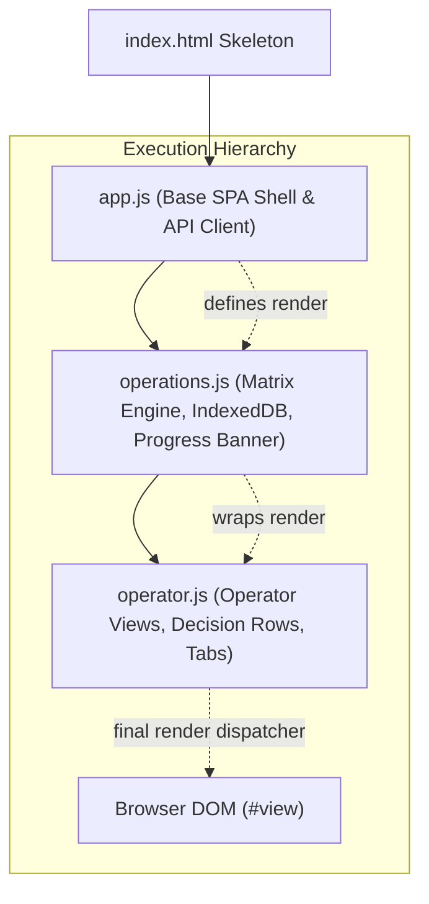

# Lazy Bean Competitor Intelligence Dashboard — Design Handoff & Reverse Engineering Specification

## Executive Summary

This documentation package provides the framework-agnostic design specification, UI/UX architecture, component catalog, interaction rules, responsive behavior, and API data contracts reverse-engineered from the **Lazy Bean Competitor Intelligence Dashboard** (`mohammedelthoqaby/lazybean-competitor-intelligence`).

The purpose of this handoff is to enable a complete frontend technology-stack migration (e.g. to Next.js, React, Vue, Svelte, or another modern frontend framework) **without redesigning, altering, or simplifying the existing user experience or visual identity**.

Every color, dimension, font size, border, layout rule, responsive breakpoint, interaction flow, and data payload documented herein was extracted directly from the existing production frontend source code (`app/static/index.html`, `app/static/style.css`, `app/static/app.js`, `app/static/operations.js`, `app/static/operator.js`) and backend API definitions (`app/api.py`, `app/analysis.py`, `app/registry.py`, `app/db.py`).

---

## 1. System Overview & Context

- **Application Name**: Lazy Bean Market Intelligence / Competitor Intelligence Operations
- **Domain**: Coffee capsules, whole beans, ground coffee, machines, and coffee accessories in Egypt (EGP currency, Cairo timezone `Africa/Cairo`).
- **Monitored Scope**:
  - **1 Reference Store**: Lazy Bean (`lazybean.co`, adapter: `lazybean`)
  - **5 Competitor Stores**:
    1. Coffee & Cream (`coffeeandcream.app`, adapter: `commerce`)
    2. CAFELAX (`www.cafelax.com`, adapter: `commerce`)
    3. Fengany (`fengany.com`, adapter: `commerce`)
    4. Coffee Zone Misr (`coffeezonemisr.com`, adapter: `commerce`)
    5. Strong Coffee (`strongcoffee-eg.com`, adapter: `woocommerce`)
  - **Advertising Channels**: Meta Ads Library and Google Ads Transparency Center.
- **Operating Philosophy**: "Evidence first. Decisions with context. Read-only intelligence. No automated pricing or ad changes."

---

## 2. Frontend Runtime & Script Architecture

The original dashboard is built with Vanilla JavaScript using a layered script loading architecture. Understanding this hierarchy is essential before migrating to a modern component-based architecture:

### Script Execution Order and Render Dispatching
1. **`app.js`**:
   - Defines base application state (`token`, `localPreview`, `currentRun`, `sourceList`, `runList`, `activeView`).
   - Handles route parsing (`parseCurrentHash`), route updating (`setRoute`), and popstate/hashchange listeners.
   - Provides utilities: `api()`, `perform()`, `esc()`, `safeURL()`, `badge()`, `money()`, `date()`.
   - Defines the initial base `render(isCurrent)` function.
2. **`operations.js`**:
   - Intercepts `render()`: `const originalRender = render; render = async function() { ... }`.
   - Mounts the Complete Price Comparison Matrix (`renderPriceMatrix`, `mountMatrixDOM`, `renderMatrixCell`).
   - Implements IndexedDB browser caching for matrix payloads (`lazybean-comparison-cache-v1`).
   - Renders the live collection progress banner (`renderLiveProgressBanner`, `computeRunProgress`).
   - Implements the complete historical price archive (`renderHistoryArchive`) and snapshot price matrix (`renderHistoricalPriceMatrix`).
   - Manages preflight collection checks and integration panels (`/integrations`).
3. **`operator.js`**:
   - Intercepts `render()` again: `const operatorOriginalRender = render; render = async function() { ... }`.
   - **Critical runtime rule**: If `activeView === 'Price comparisons'`, `operator.js` delegates execution back to `operatorOriginalRender()` (which executes `operations.js`), then updates the subtitle and status label.
   - If `activeView === 'History'` and `historySelectedSnapshotId` is set, it delegates to `renderHistoricalPriceMatrix()` in `operations.js`.
   - For all other views (`Overview`, `Weekly actions`, `Review queue`, `Ads & campaigns`, `Sources`, `History` [archive mode], `Improve recommendations`), `operator.js` generates the scannable operator interface (`.operator-view`) composed of structured decision rows (`.decision-row`), KPI buttons, tabbed layouts, and detail modal integrations.

---

## 3. Package Contents & Navigation Guide

This handoff package contains twelve comprehensive specifications and an exhaustive visual reference screenshot suite:

| Document | File | Description |
| :--- | :--- | :--- |
| **00** | [00-README.md](file:///c:/Users/Mohamed%20Atef/Downloads/Data%20Scraper/docs/design-handoff/00-README.md) | Executive summary, runtime architecture, context, and specification index (this document). |
| **01** | [01-DESIGN-SYSTEM.md](file:///c:/Users/Mohamed%20Atef/Downloads/Data%20Scraper/docs/design-handoff/01-DESIGN-SYSTEM.md) | Complete design tokens: colors, typography, spacing, borders, shadows, and component styling rules. |
| **02** | [02-APPLICATION-SHELL.md](file:///c:/Users/Mohamed%20Atef/Downloads/Data%20Scraper/docs/design-handoff/02-APPLICATION-SHELL.md) | Global shell layout: fixed sidebar, header, breadcrumb, toolbar, notice bar, live progress banner, modals, footer. |
| **03** | [03-SCREEN-INVENTORY.md](file:///c:/Users/Mohamed%20Atef/Downloads/Data%20Scraper/docs/design-handoff/03-SCREEN-INVENTORY.md) | Screen-by-screen specification: all 8 views, nested tabs, historical views, dialogs, and states. |
| **04** | [04-COMPONENT-CATALOG.md](file:///c:/Users/Mohamed%20Atef/Downloads/Data%20Scraper/docs/design-handoff/04-COMPONENT-CATALOG.md) | Reusable component library: buttons, inputs, badges, KPI cards, panels, decision rows, matrix cells, progress indicators. |
| **05** | [05-INTERACTION-SPEC.md](file:///c:/Users/Mohamed%20Atef/Downloads/Data%20Scraper/docs/design-handoff/05-INTERACTION-SPEC.md) | Detailed user interactions: filtering, search debouncing, pagination, modals, math explanations, validation flows. |
| **06** | [06-RESPONSIVE-SPEC.md](file:///c:/Users/Mohamed%20Atef/Downloads/Data%20Scraper/docs/design-handoff/06-RESPONSIVE-SPEC.md) | Breakpoint specifications: Desktop (1440px), Laptop (1050px), Tablet (900px), Mobile (720px & 390px). |
| **07** | [07-API-CONTRACTS.md](file:///c:/Users/Mohamed%20Atef/Downloads/Data%20Scraper/docs/design-handoff/07-API-CONTRACTS.md) | Frontend-to-backend API contract inventory: all 37 endpoints, parameters, bodies, and consumed properties. |
| **08** | [08-ASSETS-AND-TYPOGRAPHY.md](file:///c:/Users/Mohamed%20Atef/Downloads/Data%20Scraper/docs/design-handoff/08-ASSETS-AND-TYPOGRAPHY.md) | Branding assets, SVG geometry, icon vectors, font stacks, Cairo timezone formatting, and EGP currency rules. |
| **09** | [09-ROUTES-AND-NAVIGATION.md](file:///c:/Users/Mohamed%20Atef/Downloads/Data%20Scraper/docs/design-handoff/09-ROUTES-AND-NAVIGATION.md) | Routing rules, hash slugs, parameter serialization, aliases, redirects, and browser history synchronization. |
| **10** | [10-MIGRATION-ACCEPTANCE-CRITERIA.md](file:///c:/Users/Mohamed%20Atef/Downloads/Data%20Scraper/docs/design-handoff/10-MIGRATION-ACCEPTANCE-CRITERIA.md) | Objective verification checklist to certify that the migrated application matches existing UI/UX fidelity. |
| **11** | [11-IMPLEMENTATION-MAPPING.md](file:///c:/Users/Mohamed%20Atef/Downloads/Data%20Scraper/docs/design-handoff/11-IMPLEMENTATION-MAPPING.md) | Modern stack architectural mapping: state stores, component hierarchy, hooks, route adapters, and test strategy. |
| **Media** | [screenshots/](file:///c:/Users/Mohamed%20Atef/Downloads/Data%20Scraper/docs/design-handoff/screenshots) | 33 visual reference screenshots captured at 1440×1000 (Desktop) and 390×844 (Mobile). |

---

## 4. Key Metrics and Documentation Statistics

- **Total Screens & Sub-views Documented**: 12 (Overview, Price Comparisons, Weekly Actions - Suggested, Weekly Actions - Offers, Ads & Campaigns, Review Queue, Sources, History Archive, Historical Price Matrix, Improve Recommendations, Collection Modal, Login Modal).
- **Total Reusable Component Patterns Documented**: 18 distinct components with 45+ visual/state variants.
- **Total Interactions Documented**: 28 complete interaction specifications.
- **Total API Endpoints Mapped**: 37 frontend-consumed endpoints.
- **Total Verified Screenshots Captured**: 33 screenshots (18 Desktop @ 1440×1000, 15 Mobile @ 390×844).
- **Source Integrity**: Confirmed 100% read-only audit. No source code in the repository was modified, deleted, or refactored during inspection. No live scrapers or paid external APIs were triggered.
