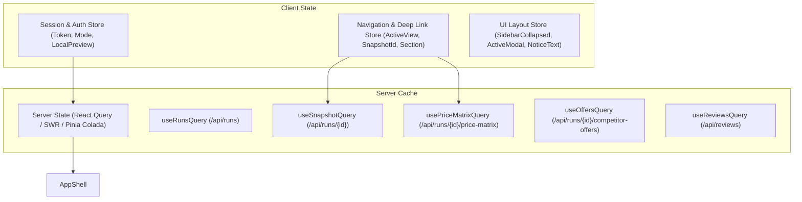

# Modern Stack Implementation Mapping — Lazy Bean Market Intelligence

This document provides a technology-independent architectural translation guide for migrating the Vanilla JavaScript dashboard to modern component-based frameworks (such as Next.js / React, Nuxt / Vue, SvelteKit, or SolidStart).

---

## 1. Application Component Hierarchy

```
<AppShell>
  <Sidebar>
    <BrandTile logo="/assets/logo.png" title="Lazy Bean" subtitle="MARKET INTELLIGENCE" />
    <Navigation activeView={activeView} reviewAttentionCount={reviewAttentionCount}>
      <NavItem href="#/overview" label="Overview" />
      <NavItem href="#/weekly-actions" label="Weekly actions" />
      <NavItem href="#/price-comparisons" label="Price comparisons" />
      <NavItem href="#/ads-campaigns" label="Ads & campaigns" />
      <NavItem href="#/review-queue" label="Reviews needing attention" badgeCount={reviewAttentionCount} />
      <NavAccordion title="Settings & history">
        <NavItem href="#/sources" label="Manage sources" />
        <NavItem href="#/history" label="Report history" />
        <NavItem href="#/improve-recommendations" label="Internal data import" />
      </NavAccordion>
    </Navigation>
    <SideNote isReadOnly={true} onLock={handleLock} isLocalPreview={isLocalPreview} />
  </Sidebar>

  <Workspace isCollapsed={isSidebarCollapsed}>
    <Header onToggleSidebar={toggleSidebar} timezone="Africa/Cairo" />
    
    <MainContent>
      <Heading title={activeView} subtitle={currentSubtitle} onRefresh={openCollectionModal} />
      <Toolbar
        snapshots={snapshots}
        selectedSnapshotId={selectedSnapshotId}
        onSelectSnapshot={handleSnapshotChange}
        onReload={handleReload}
      />
      
      {noticeMessage && <NoticeBanner message={noticeMessage} />}
      {isCollectionActive && <LiveProgressBanner run={activeRun} onCancel={handleCancelRun} />}
      
      {/* Route Outlet */}
      <ViewOutlet>
        {activeView === 'overview' && <OverviewView snapshot={currentSnapshot} />}
        {activeView === 'price-comparisons' && <PriceMatrixView snapshot={currentSnapshot} />}
        {activeView === 'weekly-actions' && <WeeklyActionsView snapshot={currentSnapshot} activeTab={weeklyTab} />}
        {activeView === 'ads-campaigns' && <AdsCampaignsView snapshot={currentSnapshot} />}
        {activeView === 'review-queue' && <ReviewQueueView />}
        {activeView === 'sources' && <SourcesView />}
        {activeView === 'history' && (
          selectedHistoricalSnapshotId
            ? <HistoricalPriceMatrixView snapshotId={selectedHistoricalSnapshotId} onBack={clearHistoricalSnapshot} />
            : <HistoryArchiveView onSelectHistoricalMatrix={selectHistoricalSnapshot} />
        )}
        {activeView === 'improve-recommendations' && <DataImportView />}
      </ViewOutlet>
    </MainContent>

    <Footer disclaimer="Observed evidence supports review. Ad presence does not establish demand or campaign success." />
  </Workspace>

  {/* Modals & Dialogs */}
  <CollectionModal isOpen={isCollectionModalOpen} onClose={closeCollectionModal} />
  <LoginModal isOpen={isLoginModalOpen} onClose={closeLoginModal} />
  <DetailEvidenceModal isOpen={isDetailModalOpen} content={detailModalContent} onClose={closeDetailModal} />
</AppShell>
```

---

## 2. Core State Management Architecture

A modern implementation should separate state into four well-defined stores/contexts:



### 2.1 State Store Definitions (TypeScript)

```typescript
export interface AppSessionState {
  token: string | null;
  mode: 'local_preview' | 'token';
  isLocalPreview: boolean;
  setToken: (token: string) => void;
  clearToken: () => void;
}

export interface RouteState {
  activeView:
    | 'overview'
    | 'price-comparisons'
    | 'weekly-actions'
    | 'ads-campaigns'
    | 'review-queue'
    | 'sources'
    | 'history'
    | 'improve-recommendations';
  selectedSnapshotId: string | null;
  selectedHistoricalSnapshotId: string | null;
  weeklyTab: 'actions' | 'offers';
  setRoute: (view: RouteState['activeView'], params?: { snapshot?: string; section?: 'offers' }) => void;
}

export interface UIState {
  isSidebarCollapsed: boolean;
  toggleSidebar: () => void;
  notice: string | null;
  setNotice: (message: string) => void;
  clearNotice: () => void;
  activeModal: 'login' | 'collection' | 'detail' | null;
  openModal: (modal: UIState['activeModal']) => void;
  closeModal: () => void;
}
```

---

## 3. Component Interface Contracts (TypeScript)

### 3.1 Status Badge Component
```typescript
export type BadgeState =
  | 'completed'
  | 'accepted'
  | 'approved'
  | 'approved_manual'
  | 'exact_auto'
  | 'validated'
  | 'in_stock'
  | 'partial'
  | 'needs_review'
  | 'needs_identity_review'
  | 'suggested'
  | 'pending_validation'
  | 'manual_evidence'
  | 'cancelled'
  | 'cancelling'
  | 'failed'
  | 'blocked'
  | 'quarantined'
  | 'rejected'
  | 'out_of_stock'
  | 'budget_exhausted'
  | 'budget_unverified'
  | 'running'
  | 'queued'
  | 'draft';

export interface StatusBadgeProps {
  state: BadgeState | string;
  size?: 'normal' | 'small'; // normal: 11px padding 3px 7px; small: 9px padding 2px 4px
  title?: string;
}
```

---

### 3.2 Decision Row Component
```typescript
export interface DecisionRowProps {
  title: string;
  actionLabel?: string;
  reason?: string;
  metaNotes?: string;
  actionButtonText?: string;
  onAction?: () => void;
  children?: React.ReactNode; // for embedded forms
}
```

---

### 3.3 Matrix Cell Component
```typescript
export interface MatrixCompetitorCellData {
  price_minor: number | null;
  reference_minor: number | null;
  currency: string;
  diff_pct: string | null;
  match_status: 'exact_auto' | 'approved_manual' | 'suggested';
  match_basis?: string;
  title: string;
  url: string;
  observed_at: string;
  availability: 'in_stock' | 'out_of_stock' | 'unknown';
  offer_scope?: string;
  in_current_run: boolean;
}

export interface MatrixCellProps {
  data: MatrixCompetitorCellData | null;
  productId: string;
  competitorId: string;
  onInspect: (productId: string, competitorId: string) => void;
  onCopyLink: (url: string) => void;
}
```

---

### 3.4 Progress Banner Component
```typescript
export interface SourceProgressData {
  source_id: string;
  name: string;
  state: BadgeState;
  accepted_products?: number;
  batch?: number;
  total_batches?: number;
  error?: string | null;
}

export interface LiveProgressBannerProps {
  percentage: number;
  label: string;
  doneCount: number;
  totalCount: number;
  acceptedObservations: number;
  sources: SourceProgressData[];
  canCancel: boolean;
  isCancelling: boolean;
  onCancel: () => void;
}
```

---

## 4. Design Token Implementation (Tailwind CSS Config)

For teams adopting **Tailwind CSS**, the existing design tokens translate directly into `tailwind.config.js`:

```javascript
/** @type {import('tailwindcss').Config} */
module.exports = {
  theme: {
    extend: {
      colors: {
        canvas: '#f5f6f8',
        surface: '#ffffff',
        ink: '#161b22',
        muted: '#626b76',
        line: '#dfe3e8',
        'line-subtle': '#edf0f2',
        action: {
          DEFAULT: '#164f40',
          hover: '#103d31',
          focus: '#388a75',
          light: '#eaf1ee',
          gradient: '#2d866c',
        },
        brand: {
          tile: '#202723',
          yellow: '#fdec0a',
          dot: '#387c60',
        },
        status: {
          'good-ink': '#236044',
          'good-bg': '#e7f3ec',
          'good-border': '#9bc9b1',
          'warn-ink': '#79520b',
          'warn-bg': '#fff3d9',
          'warn-border': '#c3a04e',
          'warn-operator': '#fff8e8',
          'bad-ink': '#962f32',
          'bad-bg': '#fbe9e9',
          'bad-border': '#e6b3b3',
          'bad-error': '#9c3030',
        },
      },
      fontFamily: {
        sans: ['"Segoe UI"', 'Arial', 'sans-serif'],
      },
      boxShadow: {
        'brand-tile': '0 2px 6px rgba(0, 0, 0, 0.12)',
        'matrix-sticky': '2px 0 5px rgba(0, 0, 0, 0.04)',
        'progress-banner': '0 2px 8px rgba(16, 61, 49, 0.06)',
      },
      borderRadius: {
        'tile': '11px',
      },
      screens: {
        'small-mobile': {'max': '520px'},
        'mobile': {'max': '720px'},
        'tablet': {'max': '900px'},
        'laptop': {'max': '1050px'},
        'desktop-sm': {'max': '1100px'},
      },
    },
  },
};
```

---

## 5. Data Fetching & Polling Strategy

### 5.1 Query Keys & Cache Rules
Using a client data library (such as TanStack React Query):

```typescript
export const queryKeys = {
  session: ['session'] as const,
  sources: ['sources'] as const,
  runs: ['runs'] as const,
  snapshot: (id: string) => ['runs', id] as const,
  priceMatrix: (id: string) => ['runs', id, 'price-matrix'] as const,
  competitorOffers: (id: string) => ['runs', id, 'competitor-offers'] as const,
  reviews: ['reviews'] as const,
  historyPrices: ['history', 'prices'] as const,
  integrations: ['integrations'] as const,
};
```

### 5.2 Dynamic Polling Hook
```typescript
export function useSnapshotQuery(runId: string | null) {
  return useQuery({
    queryKey: queryKeys.snapshot(runId!),
    queryFn: () => apiGetDetailedRun(runId!),
    enabled: Boolean(runId),
    refetchInterval: (query) => {
      const state = query.state.data?.state;
      if (state && ['queued', 'running', 'cancelling'].includes(state)) {
        return 3000; // Poll every 3 seconds while active
      }
      return false; // Stop polling on terminal state
    },
  });
}
```

---

## 6. Accessibility & ARIA Implementation

- **Skip Navigation Link**: Must include `<a class="skip" href="#content">Skip to content</a>`.
- **Keyboard Tab Control**: The weekly tabs container (`.weekly-tabs`) must maintain `role="tablist"`, with individual buttons having `role="tab"`, `aria-selected="true/false"`, and `aria-controls="{panelId}"`. Panels have `role="tabpanel"` and `aria-labelledby="{tabId}"`.
- **Status Live Regions**:
  - Notification banner: `<div id="notice" role="status">`
  - Active snapshot badge: `<span id="runStatus" aria-live="polite">`
  - Live progress banner: `<div id="liveProgressBanner" aria-live="polite">`
- **Matrix Region**:
  - The scrollable matrix container has `role="region" aria-label="Product price comparison table" tabindex="0"` to allow keyboard users to scroll horizontally.
