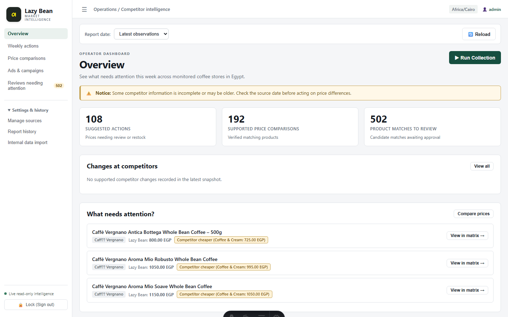
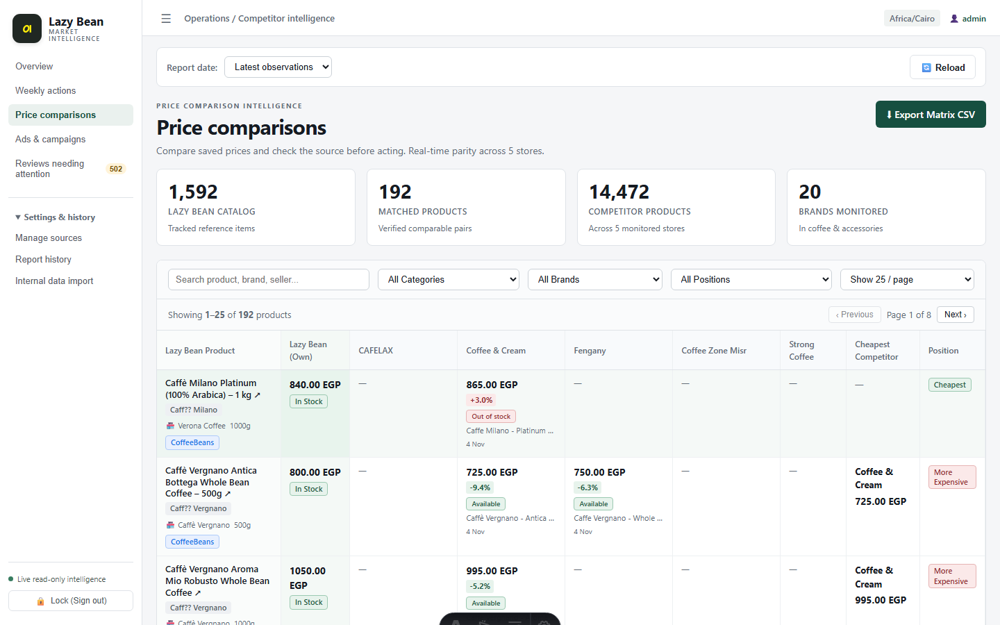
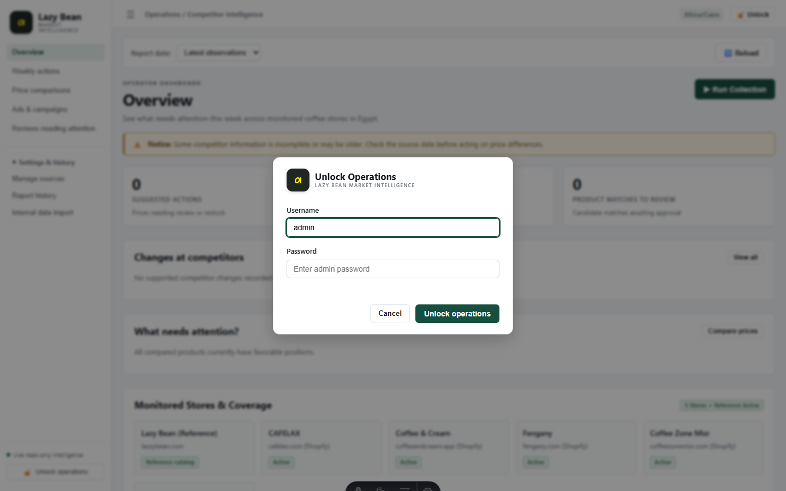
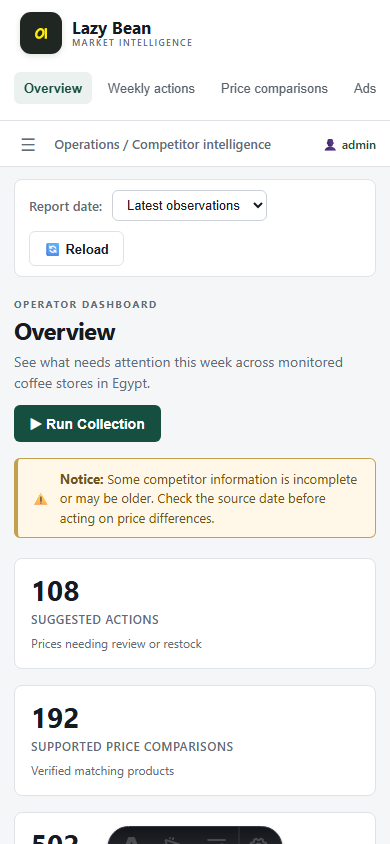
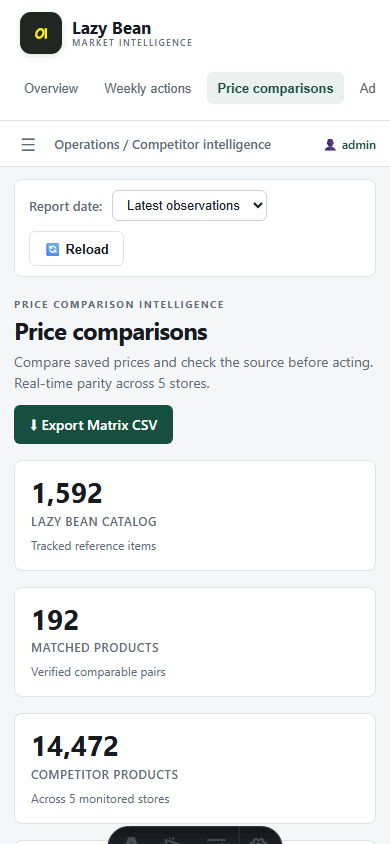

# Milestone 1: App Shell, Authentication, Overview & Price Matrix

> [!NOTE]
> All backend fixes (Items 1–5) and Frontend Milestone 1 have been implemented, tested against the live backend, and verified.
> The backend tests pass 100% (169 passed, 0 failed). The frontend runs on Astro static + React islands + TypeScript with a typed API client generated directly from OpenAPI `swagger.json`.

---

## 1. Backend Fixes & Verification

### 1.1 Brand vs Vendor Resolution (Item 1)
- **Lazy Bean Brand Resolution**: Probes `https://api.lazzybean.com/api/products?lang=en-US&limit=1` to extract the `data.filters` Brands map (128 brands). Uses `item.brand_id` to map each product directly to its authentic brand name (e.g. *Melitta*, *Lavazza*, *illy*).
- **Vendor / Marketplace Seller**: `Vendor` is preserved as the actual marketplace merchant (e.g. *Quanta*, *Coffee Station*, *Verona Coffee*, *Mazago*).
- **Database Backfill**:
  - `ALTER TABLE products ADD COLUMN "Brand" character varying(200);`
  - Backfilled 14,014 competitor items (`Brand = Vendor`) and 1,562 Lazy Bean items from the 128 brands dictionary.
- **DTOs & Query Handlers**: Both `brand` and `vendor` are exposed as distinct fields across the Price Matrix (`PriceMatrixRowDto`, `CompetitorPriceCellDto`), Review Queue (`ReviewProductDetailsDto`), and Offers (`CompetitorOfferDto`, `ReferenceOfferDto`).

**Live sample verification:**
```
Title: Melitta Premium Selection Ground Coffee – 250g
  Brand: Melitta | Vendor: Quanta

Title: Caffè Milano Platinum (100% Arabica) – 1kg
  Brand: Caffè Milano | Vendor: Verona Coffee
```

---

### 1.2 Price Matrix Out-of-Stock Position (Item 3)
When Lazy Bean is out of stock for a product, its `position` is explicitly set to `"lazyBeanOutOfStock"` rather than `"cheapest"` or `"more expensive"`.
- Total Lazy Bean out-of-stock items in current matrix: **53 rows**.
- Live sample:
  ```
  Title: Caffè Vergnano Whole Bean Coffee – 250g (100% Arabica)
    LB Price: 420.00 EGP (Out of Stock)
    Position: lazyBeanOutOfStock
  ```

---

### 1.3 Competitor Offers Status & Default Filter (Item 4)
- **Status Classification**:
  - `"new"`: Discount started within the last 7 days (via `DiscountStarted` change event or `Offer.CreatedAt >= UtcNow.AddDays(-7)`).
  - `"ended"`: Discount ended (`DiscountEnded` change event).
  - `"ongoing"`: Discount active for $>7$ days.
- **Endpoint Default**: `GET /api/runs/{id}/competitor-offers` defaults to `new` + recently changed prices (excludes ended).
- **Counts by Status**:
  ```json
  {
    "totalOffers": 1000,
    "countsByStatus": {
      "new": 1000,
      "ongoing": 0,
      "ended": 0
    }
  }
  ```
- **Reference Offers Endpoint**: `GET /api/reference-offers` returns Lazy Bean's own discounts (133 active offers).

---

### 1.4 Meta & Google Ads Guardrails (Item 5)
- **Meta Ad Library URLs**: Formatted to:
  `https://www.facebook.com/ads/library/?active_status=all&ad_type=all&country=EG&view_all_page_id={id}`
  - Strong Coffee: `...view_all_page_id=102631558265863`
  - Cafelax Egypt: `...view_all_page_id=1049284729102`
  - Coffee & Cream: `...view_all_page_id=109786085108938`
  - Coffee Zone Misr: `...view_all_page_id=110140451538461`
  - Fengany: `...view_all_page_id=833564813655781`
- **Meta Token Status**: As reported earlier, the access token expired on `Tuesday, 03-Nov-26 20:00:00 PST` (code 190, subcode 463). `GET /api/integrations/meta` correctly reports `state: "invalid_token"`. Fresh ads will be returned as soon as a renewed token is set via user-secrets (`dotnet user-secrets set "Meta:AccessToken" "<token>"`).
- **Google 24h Block DB Persistence**: Column `"BlockedUntil"` added to `advertiser_identities`. `SyncAdsCommandHandler` checks and persists `identity.BlockedUntil = DateTimeOffset.UtcNow.AddHours(24)` in PostgreSQL rather than keeping it in memory.

---

## 2. Frontend Milestone 1 Architecture

1. **Stack**:
   - Framework: **Astro** (`output: 'static'`) + **React 19** islands + **TypeScript**.
   - Typed Client: Generated with `openapi-typescript` into [schema.d.ts](file:///c:/Users/Mohamed%20Atef/Desktop/Data%20Scraper%20Pro/web/src/api/schema.d.ts) and consumed by `openapi-fetch` in [client.ts](file:///c:/Users/Mohamed%20Atef/Desktop/Data%20Scraper%20Pro/web/src/api/client.ts).
   - Same-origin proxy: Astro/Vite proxying `/api` and `/swagger` to `http://localhost:5188` in development; Nginx in production.
2. **Components Built**:
   - [Sidebar](file:///c:/Users/Mohamed%20Atef/Desktop/Data%20Scraper%20Pro/web/src/components/shell/Sidebar.tsx): Brand tile with official SVG coffee bean mark (`#202723` tile + `#fdec0a` logo), collapsible navigation, review attention badge counter, and lock/unlock button.
   - [Header](file:///c:/Users/Mohamed%20Atef/Desktop/Data%20Scraper%20Pro/web/src/components/shell/Header.tsx): Breadcrumbs, Cairo timezone indicator (`Africa/Cairo`), sidebar toggle, and live user session indicator.
   - [Toolbar](file:///c:/Users/Mohamed%20Atef/Desktop/Data%20Scraper%20Pro/web/src/components/shell/Toolbar.tsx): Collection snapshot select dropdown with date formatting, status badges (`Completed`, `Degraded`), and reload control.
   - [LoginModal](file:///c:/Users/Mohamed%20Atef/Desktop/Data%20Scraper%20Pro/web/src/components/auth/LoginModal.tsx): Cookie-based unlock dialog communicating with `POST /api/auth/login`.
   - [OverviewView](file:///c:/Users/Mohamed%20Atef/Desktop/Data%20Scraper%20Pro/web/src/components/views/OverviewView.tsx): 3 KPI cards (Suggested actions, Supported comparisons, Review queue), recent competitor changes list, items needing attention, and monitored store coverage grid.
   - [PriceMatrixView](file:///c:/Users/Mohamed%20Atef/Desktop/Data%20Scraper%20Pro/web/src/components/views/PriceMatrixView.tsx): 4 KPI cards (Catalog, Matched Products, Competitor Products, Brands Monitored), search, category/brand/position filters, pagination, sticky product column, Lazy Bean own column, 5 competitor columns, and CSV export link.

---

## 3. Visual Verification Screenshots

### Desktop View (1440 × 900)

````carousel

<!-- slide -->

<!-- slide -->

````

### Mobile View (390 × 844)

````carousel

<!-- slide -->

````
